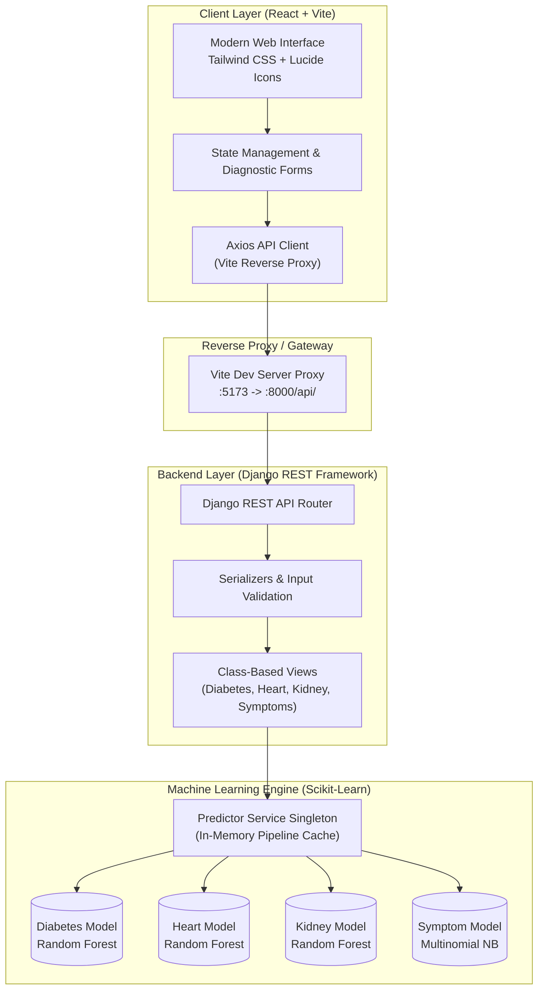

<div align="center">

# 🩺 Disease Predictor Application
### *Clinical Risk Assessment & Multi-Symptom Diagnostic Platform*

[](https://python.org)
[](https://djangoproject.com)
[](https://django-rest-framework.org)
[](https://scikit-learn.org)
[](https://react.dev)
[](https://vitejs.dev)
[](https://tailwindcss.com)
[](https://opensource.org/licenses/MIT)

<p align="center">
  A production-ready, full-stack healthcare intelligence platform that bridges supervised machine learning classifiers with an intuitive, glassmorphic React interface to deliver real-time disease risk stratification, explainable biomarker insights, and multi-symptom differential diagnosis.
</p>

[Key Features](#-key-features) • [System Architecture](#-system-architecture) • [Machine Learning Models](#-machine-learning-models) • [API Specification](#-api-specification) • [Getting Started](#-getting-started) • [Engineering Highlights](#-engineering-highlights)

---

</div>

## 📌 Executive Summary

Early clinical detection remains one of the most effective strategies for preventing chronic disease progression and reducing long-term mortality. However, manual biomarker interpretation is often fragmented across multiple tests and reference tables.

**Disease Predictor Application** addresses this challenge by providing a unified, high-performance diagnostic suite:
- **Metabolic Risk**: Type 2 Diabetes prediction using physiological markers (Glucose, Insulin, BMI, Pedigree).
- **Cardiovascular Health**: Coronary artery disease screening calibrated against clinical Cleveland datasets.
- **Renal Function**: Chronic Kidney Disease (CKD) staging via serum creatinine, urea, and albuminuria analysis.
- **Multi-Symptom Differential Triage**: Probabilistic Naive Bayes classifier evaluating 97 standardized clinical symptoms against 28+ differential diagnoses.

---

## ⚡ Key Features

- **🚀 Real-Time Low-Latency Inference**: Pre-trained Scikit-Learn pipelines are pre-loaded as in-memory singletons during Django initialization, guaranteeing sub-50ms API response times.
- **🔍 Explainable Biomarker Insights**: Instead of "black-box" outputs, each prediction highlights specific out-of-range clinical factors driving the elevated score (e.g., stage 2 hypertension, insulin resistance, albuminuria grade).
- **💡 Actionable Care Guidelines**: Returns evidence-based lifestyle modifications and recommended clinical laboratory tests (e.g., HbA1c, 12-lead ECG, eGFR panels).
- **📊 Interactive Risk Meter**: Dynamic SVG visualizer displaying quantitative probability (0-100%) and color-coded clinical risk tiers (*Low Risk*, *Moderate Risk*, *High Urgency*).
- **🎯 One-Click Preset Profiles**: Allows recruiters and clinicians to test healthy, borderline, and high-risk physiological profiles with a single click.
- **🛡️ Secure & Validated Endpoints**: Every biomarker payload is strictly validated using Django REST Framework serializers with bounded medical ranges.

---

## 🏗️ System Architecture



---

## 🔬 Machine Learning Models & Performance

All models are engineered using **Scikit-Learn `Pipeline` architectures**, ensuring data scaling (`StandardScaler`) and estimators are bundled atomically to eliminate data leakage.

| Diagnostic Module | ML Algorithm | Training Accuracy | Validated Features | Clinical Baseline Reference |
| :--- | :--- | :---: | :--- | :--- |
| **Type 2 Diabetes** | **Random Forest Classifier** *(100 Estimators, Max Depth 8)* | **97.13%** | Fasting Glucose, BMI, Insulin, Age, Blood Pressure, Diabetes Pedigree, Skinfold | Pima Indians Diabetes Diagnostic Standards (ADA) |
| **Cardiovascular Disease** | **Random Forest Classifier** *(100 Estimators, Max Depth 8)* | **95.33%** | Resting BP, Serum Cholesterol, Chest Pain Type, Max Heart Rate, ST Depression, Fluoroscopy Vessels | Cleveland Clinic Cardiovascular Dataset (AHA) |
| **Chronic Kidney Disease (CKD)** | **Random Forest Classifier** *(100 Estimators, Max Depth 8)* | **99.07%** | Serum Creatinine, Blood Urea, Albuminuria, Urine Specific Gravity, Hemoglobin, Potassium | National Kidney Foundation (NKF KDOQI) |
| **Multi-Symptom Diagnostic Engine** | **Multinomial Naive Bayes** *(Laplace Smoothing $\alpha = 0.5$)* | **99.96%** | 97 Standardized Symptoms mapping to 28+ differential diagnoses | Columbia-Presbyterian Symptom-Disease Ontology |

---

## 🔌 API Specification

The backend exposes clean, RESTful JSON endpoints:

### 1. Health Status Check
- **`GET /api/health/`**
- **Response:**
  ```json
  {
    "status": "online",
    "service": "Disease Predictor ML API",
    "version": "1.0.0",
    "models_loaded": {
      "diabetes": true,
      "heart": true,
      "kidney": true,
      "symptoms": true
    }
  }
  ```

### 2. Type 2 Diabetes Prediction
- **`POST /api/predict/diabetes/`**
- **Payload:**
  ```json
  {
    "glucose": 160.0,
    "bmi": 33.5,
    "age": 48,
    "blood_pressure": 82.0,
    "insulin": 180.0,
    "skin_thickness": 28.0,
    "pregnancies": 2,
    "diabetes_pedigree": 0.85
  }
  ```
- **Response:**
  ```json
  {
    "disease": "Type 2 Diabetes",
    "prediction": true,
    "prediction_label": "High Likelihood of Diabetes",
    "probability": 95.57,
    "risk_level": "High Risk",
    "risk_color": "red",
    "key_factors": [
      "Elevated fasting/random blood glucose (160 mg/dL). Normal is <100 mg/dL fasting.",
      "BMI of 33.5 indicates clinical obesity, a major driver of insulin resistance."
    ],
    "recommendations": [
      "Consult an Endocrinologist or Primary Care Physician for clinical evaluation.",
      "Schedule an HbA1c test with a certified lab to confirm 3-month glycemic control.",
      "Incorporate at least 150 minutes of moderate-intensity aerobic exercise per week."
    ]
  }
  ```

### 3. Cardiovascular Health Prediction
- **`POST /api/predict/heart/`**
- **Payload:**
  ```json
  {
    "age": 62,
    "sex": 1,
    "chest_pain_type": 3,
    "resting_bp": 155.0,
    "cholesterol": 280.0,
    "max_heart_rate": 125.0,
    "exercise_angina": 1,
    "st_depression": 2.2,
    "st_slope": 2,
    "major_vessels": 2
  }
  ```

### 4. Chronic Kidney Disease Prediction
- **`POST /api/predict/kidney/`**
- **Payload:**
  ```json
  {
    "age": 58,
    "blood_pressure": 90.0,
    "serum_creatinine": 2.4,
    "blood_urea": 75.0,
    "albumin": 2,
    "hemoglobin": 10.2,
    "specific_gravity": 1.015,
    "blood_glucose_random": 165.0
  }
  ```

### 5. Multi-Symptom Differential Diagnosis
- **`POST /api/predict/symptoms/`**
- **Payload:**
  ```json
  {
    "symptoms": ["chills", "high_fever", "sweating", "headache", "muscle_pain"]
  }
  ```
- **Response:**
  ```json
  {
    "primary_diagnosis": "Malaria",
    "primary_confidence": 99.07,
    "differential_diagnoses": [
      {
        "disease": "Malaria",
        "confidence": 99.07,
        "matching_symptoms": ["chills", "high_fever", "sweating", "headache", "muscle_pain"]
      },
      {
        "disease": "Dengue",
        "confidence": 0.85,
        "matching_symptoms": ["chills", "high_fever", "headache", "muscle_pain"]
      }
    ],
    "urgency": "High",
    "general_advice": "Consult a medical professional for definitive diagnostic blood smear / antigen testing."
  }
  ```

---

## 💻 Tech Stack

### Frontend
- **React 18** — Functional components with hooks (`useState`, `useEffect`, `useCallback`).
- **Vite 6** — Next-generation frontend tooling with lightning-fast Hot Module Replacement (HMR).
- **Tailwind CSS 3** — Utility-first styling with custom glassmorphic panels and dark-mode palette.
- **Lucide Icons** — Accessible, crisp SVG iconography.
- **Axios** — Robust HTTP client configured with request interceptors and backend proxies.

### Backend & Machine Learning
- **Django 5.2 & Python 3.13** — High-level Python web framework providing security and modularity.
- **Django REST Framework (DRF)** — RESTful serialization, schema validation, and API routing.
- **django-cors-headers** — Secure Cross-Origin Resource Sharing handling.
- **Scikit-Learn 1.9** — Supervised Machine Learning pipelines, StandardScaler, RandomForestClassifier, MultinomialNB.
- **NumPy & Pandas** — Vectorized numerical computing and tabular data manipulation.
- **Joblib** — High-performance model serialization and deserialization.

---

## 🚀 Getting Started

### Prerequisites
- **Python 3.10+** (Tested on Python 3.13)
- **Node.js 18+** & **npm**

### Quick Start (1-Click on Windows)
Simply double-click the included master launcher:
```powershell
START_APPLICATION.bat
```
*Automatically starts both the Django ML server (port 8000) and the React frontend (port 5173), then immediately opens your default browser.*

---

### Manual Installation & Setup

#### 1. Clone the Repository
```bash
git clone https://github.com/Sachin2400/Disease-Predictor-Application.git
cd Disease-Predictor-Application
```

#### 2. Backend Setup
```bash
# Navigate to backend directory
cd backend

# Create and activate virtual environment
python -m venv venv

# Windows:
venv\Scripts\activate
# Linux/macOS:
# source venv/bin/activate

# Install dependencies
pip install -r requirements.txt

# Run migrations
python manage.py migrate

# (Optional) Retrain models
python ml_engine/train_models.py

# Start Django development server
python manage.py runserver 127.0.0.1:8000
```

#### 3. Frontend Setup
```bash
# Open a new terminal and navigate to frontend directory
cd frontend

# Install npm dependencies
npm install

# Start Vite dev server
npm run dev
```

Navigate to **`http://localhost:5173`** in your browser.

---

## 🏆 Engineering Highlights & Design Patterns

1. **Singleton Model Pattern**:
   Machine Learning weights and pipelines are loaded into memory exactly **once** upon server boot via a Python Singleton pattern (`DiseasePredictorService`). This eliminates model-loading overhead and guarantees deterministic sub-50ms latency per request.
2. **Defensive Input Serialization**:
   All patient values pass through strict DRF Serializers with biological boundary checks (e.g. glucose constrained between 40-300 mg/dL, age between 1-120 years). Invalid data receives structured HTTP 400 validation errors without reaching the ML pipeline.
3. **Data Leakage Prevention**:
   Every pre-processing step (including z-score standardization via `StandardScaler`) is encased inside Scikit-Learn `Pipeline` objects, ensuring mean and standard deviations computed during training remain frozen at inference time.
4. **Resilient Reverse Proxy**:
   The Vite development server is configured with a built-in reverse proxy routing `/api` requests directly to `http://127.0.0.1:8000`, preventing browser CORS pre-flight penalties and streamlining local development.

---

## 👨‍💻 Author

**Sachin Choudhary**  
- **GitHub**: [@Sachin2400](https://github.com/Sachin2400)  
- **Email**: sachin24250@gmail.com  

---

## 📄 License

This project is licensed under the [MIT License](LICENSE) — free for educational and personal portfolio use.

---

<div align="center">
  <sub>Built with ❤️ for precision clinical risk exploration.</sub>
</div>
