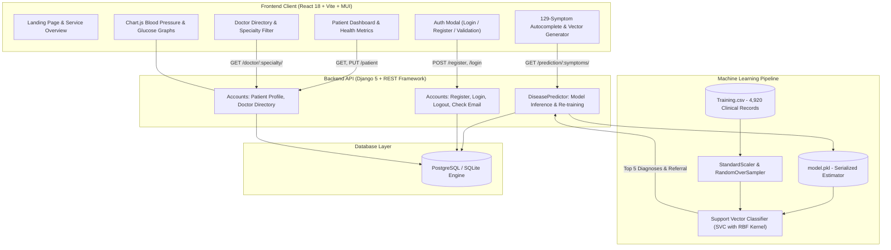
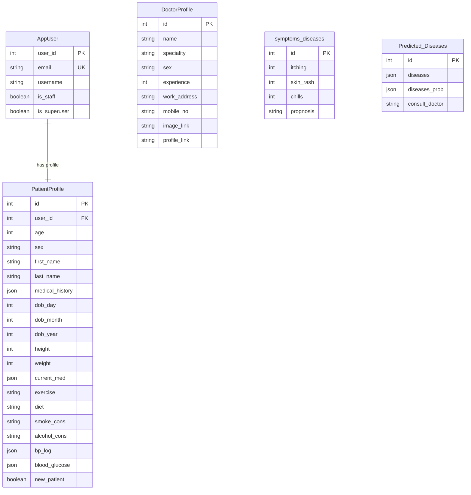

# 🏥 Medware — Predictive Clinical Diagnostics & Patient Health Intelligence Platform

[](https://www.python.org/)
[](https://www.djangoproject.com/)
[](https://www.django-rest-framework.org/)
[](https://reactjs.org/)
[](https://vitejs.dev/)
[](https://scikit-learn.org/)
[](https://tailwindcss.com/)
[](https://mui.com/)
[](https://www.chartjs.org/)

---

## 📌 Project Overview

**Medware** is an end-to-end, full-stack healthcare web application engineered to bridge predictive clinical data science with proactive personal health monitoring. Built using a modern decoupled architecture—**Django REST Framework** powering the backend and **React 18 (Vite)** on the frontend—Medware allows users to evaluate symptomatic patterns across **129 clinical features**, predict disease probability distributions across **41 medical conditions** using a calibrated **Support Vector Machine (SVM)**, receive automated medical specialist referrals, and log longitudinal vital health statistics (Blood Pressure & Blood Glucose).

---

## 🌟 Key Functional Pillars

### 1. Multi-Symptom Diagnostic Engine
- **129-Symptom Binary Vector Encoding**: The client-side autocomplete allows users to select arbitrary combinations of symptoms, which are dynamically serialized into a sparse binary feature vector.
- **Calibrated Support Vector Classifier (SVC)**: Computes hyperplanes across multi-class distributions to yield top-5 ranked differential diagnoses with confidence percentages.
- **Clinical Specialist Referral Matrix**: Automatically correlates predicted disease pathologies to appropriate medical specialties (e.g., Cardiology, Endocrinology, Gastroenterology, Dermatology, Neurology, Rheumatology, Urology).

### 2. Longitudinal Patient Health Dashboard
- **Dynamic Biometric Tracking**: Calculates real-time Body Mass Index (BMI) with risk category badges (Underweight, Normal, Overweight, Obese).
- **Blood Pressure Trends**: Interactive dual-axis visualizations (`Chart.js`) plotting Systolic and Diastolic measurements against clinical hypertension thresholds.
- **Blood Glucose Trends**: Pre-prandial and post-prandial glucose tracking with automated visual flags for hyperglycemic and hypoglycemic ranges.
- **Interactive Calendar & Log Modals**: Allows daily timestamped entry of vitals and lifestyle habits (dietary preference, exercise routines, smoking and alcohol consumption).

### 3. Medical Specialist Directory
- **80 Verified Physician Profiles**: Pre-seeded database of medical practitioners across 20 distinct medical departments.
- **Dynamic Search & Filtering**: Real-time filtering by clinical department with randomized profile rotation and direct tele-consultation shortcuts.

### 4. Authentication & Security
- **Custom User Entity (`AppUser`)**: Email-first authentication extending Django's `AbstractBaseUser`.
- **Asynchronous Email Validation**: Live AJAX verification during registration to ensure zero duplicate accounts before form submission.
- **Session-Based Protection**: Protected endpoints using CSRF tokens and secure HTTP cookies across REST endpoints.

---

## 🏛️ System Architecture



---

## 🧠 Machine Learning Formulation

### 1. Mathematical Foundation (Support Vector Machines)
The core diagnostic engine models symptom patterns using a **Support Vector Classifier (SVC)** with Radial Basis Function (RBF) kernels. Given training pairs $(x_i, y_i)$ where $x_i \in \{0, 1\}^{129}$ and $y_i \in \{1, \dots, 41\}$:

$$\min_{w, b, \xi} \frac{1}{2} \|w\|^2 + C \sum_{i=1}^n \xi_i$$
$$\text{subject to } y_i (w \cdot \phi(x_i) + b) \geq 1 - \xi_i, \quad \xi_i \geq 0$$

- **Class Balancing**: Multi-class medical data often exhibits disproportionate symptom density. The training pipeline uses `imblearn.over_sampling.RandomOverSampler` to synthesize balanced class frequencies across under-represented pathologies.
- **Probability Calibration (Platt Scaling)**: The classifier employs calibrated probability estimates (`probability=True`) to produce continuous confidence distributions rather than rigid discrete decisions, allowing patient risk ranking across differential diagnoses.

---

## 🗄️ Database Design



---

## 🔌 API Endpoints Reference

| HTTP Method | Endpoint | Description | Access Control |
|:---|:---|:---|:---:|
| `POST` | `/register` | Register new user account with password complexity validation | Public |
| `POST` | `/login` | Authenticate credentials and initiate user session | Public |
| `POST` | `/logout` | Invalidate active user session | Public |
| `GET`  | `/user` | Fetch currently authenticated user session details | Authenticated |
| `GET`  | `/check_email?email=<val>` | Real-time email uniqueness check for registration form | Public |
| `GET`  | `/patient` | Retrieve patient vitals, medical history, and clinical logs | Authenticated |
| `PUT`  | `/patient` | Update patient personal biometrics, habits, and measurements | Authenticated |
| `GET`  | `/doctor/<str:sp>/` | Fetch physicians filtered by medical specialty (or `"All"`) | Public |
| `GET`  | `/prediction/<str:symptoms>/` | Execute SVM classification on binary feature vector | Public |
| `GET`  | `/insert` | Seed 80 clinical physician profiles into the database | Public |
| `GET`  | `/insertpd` | Seed 4,920 clinical training records into database | Public |
| `GET`  | `/train` | Trigger re-training and re-serialization of `model.pkl` | Public |

---

## 📂 Project Structure

```text
Disease Predictor Application/
├── Accounts/                           # Authentication, Patient Biometrics & Doctor Directory App
│   ├── migrations/                     # Schema migrations (0001_initial.py)
│   ├── admin.py                        # Django administration registrations
│   ├── apps.py                         # Application configuration
│   ├── models.py                       # AppUser, PatientProfile, DoctorProfile, symptoms_diseases
│   ├── serializers.py                  # Django REST Framework ModelSerializers
│   ├── validations.py                  # Custom password rules & email format sanitizers
│   ├── views.py                        # Authentication, profile CRUD, and doctor endpoints
│   └── urls.py                         # Accounts URL routing
├── backend/                            # Django project core & server configuration
│   ├── settings.py                     # Dual-engine database config (Postgres + SQLite fallback)
│   ├── urls.py                         # Global URL router
│   ├── views.py                        # SPA template & asset routing
│   ├── wsgi.py / asgi.py               # WSGI / ASGI production deployment handlers
│   └── venv/                           # Python virtual environment
├── DiseasePredictor/                   # Machine Learning Prediction & Training App
│   ├── views.py                        # Model inference, data scaling, and training logic
│   ├── urls.py                         # Prediction route definitions
│   └── Training.csv                    # 4,920 clinical samples dataset
├── frontend/                           # React 18 + Vite Single Page Application
│   ├── src/
│   │   ├── assets/
│   │   │   ├── components/             # 30+ Modular React Components
│   │   │   │   ├── Header.jsx          # Adaptive navigation bar with responsive drawer
│   │   │   │   ├── Hero.jsx            # Landing hero with CTA buttons
│   │   │   │   ├── Services.jsx        # Clinical service showcases
│   │   │   │   ├── About.jsx           # Mission statement and platform features
│   │   │   │   ├── dpWindow.jsx        # Dynamic symptom selector and diagnosis console
│   │   │   │   ├── searchSymptoms.jsx  # MUI Autocomplete symptom search input
│   │   │   │   ├── Prediction.jsx      # Top-5 prognosis cards & probability badges
│   │   │   │   ├── Dashboard.jsx       # Central patient portal container
│   │   │   │   ├── PatientForm.jsx     # Onboarding biometrics registration form
│   │   │   │   ├── PatientProfile.jsx  # Health metrics, BMI evaluation, and vital logs
│   │   │   │   ├── BP_chart.jsx        # Chart.js blood pressure visualization
│   │   │   │   ├── Sugar_chart.jsx     # Chart.js blood glucose trend line graph
│   │   │   │   ├── ContactDoctor.jsx   # Doctor directory and search console
│   │   │   │   ├── DoctorProfile.jsx   # Specialist cards with phone links & profile views
│   │   │   │   ├── Calendar.jsx        # Custom calendar date selector
│   │   │   │   ├── LogModal.jsx        # Vital measurements logging modal
│   │   │   │   ├── ProfileModal.jsx    # Patient demographics modification modal
│   │   │   │   ├── Record.jsx          # Medical history & medication update modal
│   │   │   │   ├── ConsumptionModal.jsx# Smoking & alcohol habit tracking modal
│   │   │   │   └── context.jsx         # React Context API global state manager
│   │   │   └── img/                    # Curated SVG vectors, icons, and illustrations
│   │   ├── App.jsx                     # Application routing definitions
│   │   ├── App.css                     # Custom styling, fonts, and responsive utilities
│   │   └── main.jsx                    # React 18 createRoot bootstrap
│   ├── package.json                    # Frontend dependencies
│   └── vite.config.js                  # Vite build tooling configuration
├── model.pkl                           # Serialized Support Vector Classifier model artifact
├── Training.csv                        # Primary training dataset
├── manage.py                           # Django command-line administrative utility
├── START_APPLICATION.bat               # Windows launcher for concurrent server startup
├── run_backend.bat                     # Windows launcher for Django server
├── run_frontend.bat                    # Windows launcher for Vite dev server
└── requirements.txt                    # Python environment specifications
```

---

## 🚀 Installation & Local Development

### Prerequisites
- **Python 3.10+** (Tested on Python 3.13)
- **Node.js 18+** & **npm**
- **Git**

### 1. Clone the Repository
```bash
git clone https://github.com/Sachin2400/Disease-Predictor-Application.git
cd "Disease Predictor Application"
```

### 2. Backend Setup
```bash
# Activate the Python virtual environment
call backend\venv\Scripts\activate.bat   # Windows
# or: source backend/venv/bin/activate  # macOS / Linux

# Install required Python packages
pip install -r requirements.txt

# Apply database migrations
python manage.py migrate

# Seed doctor directory and training dataset
python manage.py shell -c "from Accounts.views import insert_data; insert_data(None)"
python manage.py shell -c "from DiseasePredictor.views import insert_patient_data; insert_patient_data(None)"

# Start Django development server
python manage.py runserver 127.0.0.1:8000
```

### 3. Frontend Setup
```bash
cd frontend

# Install npm packages
npm install

# Start Vite development server
npm run dev
```

### 4. Windows One-Click Quick Start
Double-click `START_APPLICATION.bat` in the project root directory. The script automatically launches the Django REST server (`http://127.0.0.1:8000`) and the Vite dev server (`http://localhost:5173`) in independent console windows.

---

## 🔬 Testing the Prediction Engine

You can test the machine learning model endpoint directly via `curl` or Postman by sending a binary symptom string:

```bash
# Predict diagnosis for a 129-feature binary vector
curl http://127.0.0.1:8000/prediction/0100000000000000000000000000000000000000000000000000000000000000000000000000000000000000000000000000000000000000000000000000000000/
```

**Output:**
```json
[
  {
    "diseases": [
      "Fungal infection",
      "Heart attack",
      "Chronic cholestasis",
      "Hepatitis C",
      "Jaundice"
    ],
    "diseases_prob": [
      0.219,
      0.142,
      0.109,
      0.086,
      0.070
    ],
    "consult_doctor": "Dermatologist"
  }
]
```

---

## 👨‍💻 Author & Engineering Credits

- **Developer**: [Sachin](https://github.com/Sachin2400)
- **Role**: Full-Stack & Machine Learning Developer
- **Repository**: [Sachin2400/Disease-Predictor-Application](https://github.com/Sachin2400/Disease-Predictor-Application.git)

---

## 📄 License

This project is licensed under the MIT License — see the [LICENSE](LICENSE) file for details.
