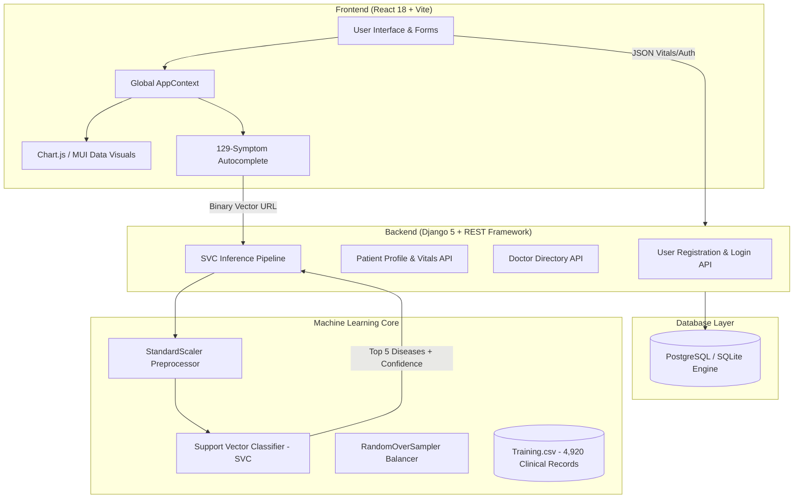

# 🏥 Medware — Disease Predictor & Patient Health Intelligence Platform

[](https://www.python.org/)
[](https://www.djangoproject.com/)
[](https://www.django-rest-framework.org/)
[](https://reactjs.org/)
[](https://vitejs.dev/)
[](https://scikit-learn.org/)
[](https://tailwindcss.com/)
[](https://mui.com/)
[](https://www.chartjs.org/)

---

## 📌 Executive Summary

**Medware** is a full-stack, enterprise-grade clinical diagnostics and health tracking web application. By bridging **Support Vector Machine (SVC)** machine learning models with a **Django REST** backend and a responsive **React 18** client, Medware provides individuals and healthcare practitioners with instantaneous disease prognosis across **41 medical conditions**, intelligent specialist referrals, and longitudinal vital signs analytics (Blood Pressure and Blood Glucose charting).

---

## ✨ Key Features & Capabilities

### 🧠 1. Intelligent Disease Predictor Engine
- **Multi-Symptom Diagnostic Formulation**: Evaluates combinations of **129 clinical symptoms** in real time.
- **Support Vector Classifier (SVC)**: Built using `scikit-learn` with calibrated probability estimators (`predict_proba`) and balanced oversampling (`RandomOverSampler`) to handle multi-class medical distributions accurately.
- **Top-5 Ranked Prognosis**: Outputs differential diagnoses ranked by confidence percentage.
- **Automated Specialist Referral Matrix**: Intelligently maps predictions to appropriate medical specialties (Cardiologist, Neurologist, Dermatologist, Gastroenterologist, ENT Specialist, Rheumatologist, Allergist/Immunologist, Urologist, etc.).

### 📊 2. Longitudinal Patient Health Dashboard
- **Real-Time BMI Computation**: Instant body mass index evaluation categorized into color-coded clinical ranges (Underweight, Normal, Overweight, Obese).
- **Blood Pressure Trends**: Interactive Bar & Scatter visualizations (`Chart.js`) illustrating Systolic and Diastolic logs against hypertension thresholds.
- **Blood Glucose Monitoring**: Pre-prandial and post-prandial glucose tracking with automatic hyper/hypoglycemia visual indicators.
- **Interactive Calendar & Log Modals**: Date-stamped entries with modal interfaces for vital signs and lifestyle factors (exercise frequency, diet type, smoking/alcohol intake).

### 👨‍⚕️ 3. Clinical Specialist Directory
- **80 Medical Specialists**: Searchable directory populated across 20 medical disciplines.
- **Live Filtering**: Instant specialty filtering with asynchronous pagination and randomized doctor rotation.
- **Direct Tele-Consultation**: Direct telephone calling links and physician profile previews.

### 🔐 4. Secure Authentication & Profile System
- **Custom AppUser Model**: Email-first authentication using Django's `AbstractBaseUser` and session management.
- **Real-Time Email Uniqueness Check**: Asynchronous AJAX validation during registration to ensure zero duplicate user accounts.
- **Protected Endpoints**: Session-based authentication with CSRF token verification across all sensitive health records.

---

## 🏛️ System Architecture



---

## 🗄️ Database Schema & Data Models

| Model | Table Name | Purpose |
|:------|:-----------|:--------|
| **`AppUser`** | `Accounts_appuser` | Custom user entity using email credentials and superuser permissions. |
| **`PatientProfile`** | `Accounts_patientprofile` | Patient biometrics, date of birth, diet, exercise habits, `bp_log` JSON, and `blood_glucose` JSON. |
| **`DoctorProfile`** | `Accounts_doctorprofile` | 80 pre-seeded clinical doctors categorized by specialty, address, experience, and contact numbers. |
| **`symptoms_diseases`** | `symptoms_diseases` | 4,920 row training dataset containing 129 binary symptom columns and target `prognosis`. |
| **`Predicted_Diseases`** | `Accounts_predicted_diseases` | Last generated diagnostic prediction, probability distributions, and referral specialist. |

---

## 🔌 API Endpoints Reference

| Method | Endpoint | Description | Auth Required |
|:-------|:---------|:------------|:-------------:|
| `POST` | `/register` | Register a new user with custom email & password validation | No |
| `POST` | `/login` | Authenticate user credentials and establish session | No |
| `POST` | `/logout` | Invalidate active session | No |
| `GET`  | `/user` | Retrieve authenticated user profile | Yes |
| `GET`  | `/check_email?email=<val>` | Verify email availability asynchronously | No |
| `GET`  | `/patient` | Fetch logged-in patient vitals, medical history, and charts | Yes |
| `PUT`  | `/patient` | Update patient vitals, logs, or personal information | Yes |
| `GET`  | `/doctor/<str:sp>/` | List doctors by specialty (or `"All"`) | No |
| `GET`  | `/prediction/<str:symptoms>/` | Run SVM model prediction on 129-symptom binary vector | No |
| `GET`  | `/insert` | Seed doctor directory records into database | No |
| `GET`  | `/insertpd` | Seed patient dataset from `Training.csv` into database | No |
| `GET`  | `/train` | Retrain SVC classifier and update `model.pkl` | No |

---

## 📁 Repository Directory Structure

```text
Disease Predictor Application/
├── Accounts/                           # Authentication, Patient & Doctor Profile App
│   ├── migrations/                     # Database migrations
│   ├── admin.py                        # Django Admin model registration
│   ├── apps.py                         # App configuration
│   ├── models.py                       # AppUser, PatientProfile, DoctorProfile, symptoms_diseases
│   ├── serializers.py                  # DRF ModelSerializers
│   ├── validations.py                  # Custom password and email validations
│   ├── views.py                        # Auth, Profile, and Doctor Directory views
│   └── urls.py                         # Accounts routing
├── backend/                            # Django project configuration & virtual environment
│   ├── settings.py                     # Project settings (dual Postgres/SQLite support)
│   ├── urls.py                         # Main URL dispatcher
│   ├── views.py                        # Single-page application template serving
│   ├── wsgi.py / asgi.py               # WSGI and ASGI server entries
│   └── venv/                           # Python virtual environment
├── DiseasePredictor/                   # Machine Learning Prediction App
│   ├── migrations/                     # App migrations
│   ├── views.py                        # Model prediction, dataset seeding, training views
│   ├── urls.py                         # Prediction routing
│   └── Training.csv                    # 4,920 patient clinical dataset
├── frontend/                           # React 18 + Vite Frontend
│   ├── src/
│   │   ├── assets/
│   │   │   ├── components/             # 30+ Modular React Components
│   │   │   │   ├── Header.jsx          # Dynamic navigation bar
│   │   │   │   ├── Hero.jsx            # Landing hero section
│   │   │   │   ├── Services.jsx        # Healthcare services overview
│   │   │   │   ├── About.jsx           # Platform mission section
│   │   │   │   ├── dpWindow.jsx        # Interactive symptom selector & prediction interface
│   │   │   │   ├── searchSymptoms.jsx  # MUI Autocomplete symptom search
│   │   │   │   ├── Prediction.jsx      # Top-5 prognosis cards & probability badges
│   │   │   │   ├── Dashboard.jsx       # Patient personal health dashboard
│   │   │   │   ├── PatientProfile.jsx  # Health metrics, BMI, and vital logs
│   │   │   │   ├── BP_chart.jsx        # Chart.js blood pressure bar visualization
│   │   │   │   ├── Sugar_chart.jsx     # Chart.js blood glucose trend line graph
│   │   │   │   ├── ContactDoctor.jsx   # Doctor directory and search
│   │   │   │   ├── DoctorProfile.jsx   # Specialist cards with calling actions
│   │   │   │   ├── Calendar.jsx        # Custom date picker
│   │   │   │   └── context.jsx         # Global state & authentication provider
│   │   │   └── img/                    # SVG assets and clinical vectors
│   │   ├── App.jsx                     # Route definitions (Predictor, Dashboard, Consult)
│   │   ├── App.css                     # Custom animations and CSS design tokens
│   │   └── main.jsx                    # Vite React DOM entry
│   ├── package.json                    # Frontend dependencies
│   └── vite.config.js                  # Vite bundler configuration
├── model.pkl                           # Trained Support Vector Classifier model artifact
├── Training.csv                        # Primary training dataset
├── manage.py                           # Django root administrative entry point
├── START_APPLICATION.bat               # One-click dual-server launcher
├── run_backend.bat                     # Backend server launcher
├── run_frontend.bat                    # Frontend dev server launcher
└── requirements.txt                    # Python dependencies
```

---

## 🚀 Getting Started

### Prerequisites
- **Python 3.10+** (Tested on Python 3.13)
- **Node.js 18+** & **npm**
- **Git**

### 1. Clone the Repository
```bash
git clone https://github.com/Sachin2400/Disease-Predictor-Application.git
cd "Disease Predictor Application"
```

### 2. Backend Setup
```bash
# Activate virtual environment
call backend\venv\Scripts\activate.bat   # Windows
# or: source backend/venv/bin/activate  # macOS / Linux

# Install dependencies
pip install -r requirements.txt

# Apply migrations
python manage.py migrate

# (Optional) Seed doctor and training data
python manage.py shell -c "from Accounts.views import insert_data; insert_data(None)"
python manage.py shell -c "from DiseasePredictor.views import insert_patient_data; insert_patient_data(None)"

# Run backend development server
python manage.py runserver 127.0.0.1:8000
```

### 3. Frontend Setup
```bash
cd frontend

# Install dependencies
npm install

# Start Vite development server
npm run dev
```

### 4. One-Click Launch (Windows)
Double-click `START_APPLICATION.bat` in the root folder to start both the Django backend (`http://127.0.0.1:8000`) and the Vite React frontend (`http://localhost:5173`) in independent windows.

---

## 🧪 Testing the ML Prediction Engine

You can test prediction directly using any HTTP client or browser:

```bash
# Pass 129 binary indicator string (1 for presence, 0 for absence)
curl http://127.0.0.1:8000/prediction/010000000000000000000000000000000000000000000000000000000000000000000000000000000000000000000000000000000000000000000000000000000/
```

**Response:**
```json
[
  {
    "diseases": [
      "Fungal infection",
      "Heart attack",
      "Chronic cholestasis",
      "Hepatitis C",
      "Jaundice"
    ],
    "diseases_prob": [
      0.219,
      0.142,
      0.109,
      0.086,
      0.070
    ],
    "consult_doctor": "Dermatologist"
  }
]
```

---

## 👨‍💻 Author & Contributions

- **Developer**: [Sachin](https://github.com/Sachin2400)
- **Project**: Medware — Disease Predictor Application
- **Repository**: [Disease-Predictor-Application](https://github.com/Sachin2400/Disease-Predictor-Application.git)

---

## 📄 License

This project is licensed under the MIT License — see the [LICENSE](LICENSE) file for details.
